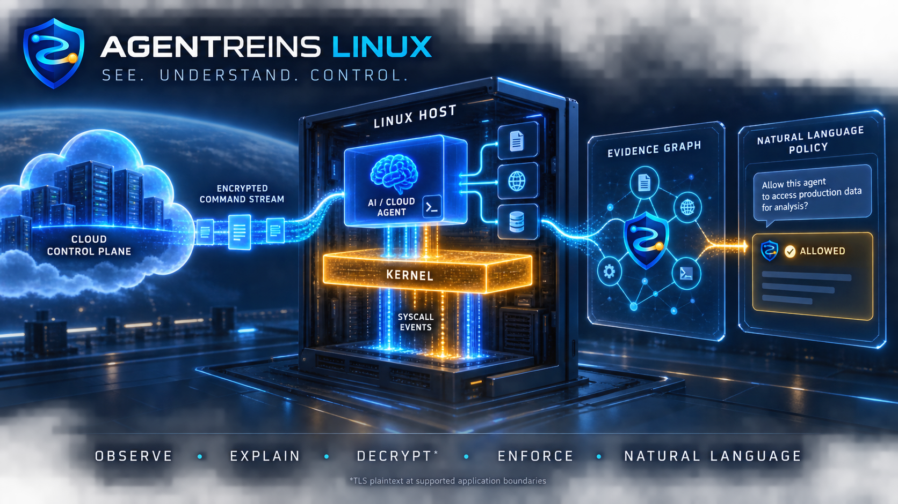

<div align="center">
  

  # AgentReins Linux

  **Kernel-aware runtime security and natural-language control for high-privilege agents.**

  [](#)
  [](#)
  [](#)
  [](#)
  [](#)

  [Live Security Intelligence](https://www.chuhaijian.com/agentsec/) ·
  [Architecture](docs/ARCHITECTURE.md) ·
  [Natural-Language Policy](docs/NATURAL-LANGUAGE-POLICY.md)
</div>

---

把 Linux 主机上的高权限 Agent，变成一条可以看见、搜索和追溯的证据链。

AgentReins Linux 持续解析进程血缘、远程指令、文件访问、网络传播、权限使用与执行结果。它不只告诉你“某个 Agent 建立了连接”，而是回答：谁下发了什么、哪个进程执行、触碰了哪些资源、向哪里传播，以及最终返回了什么。

## 核心能力

- **控制链还原**：关联控制消息、任务 ID、完整命令、执行身份、工作目录、PID 和退出结果。
- **内核行为解析**：记录进程、文件、网络与 capability 事件，并保留原始证据。
- **容器归属**：把宿主 PID 命名空间中的进程回填到具体容器与镜像，沙箱行为不需要在容器内安装任何东西。
- **外网访问审计**：按连接粒度记录出口目标与归属进程，区分授权靶标、内网与对外出网。
- **跨层关联**：通过时间、PID、父子关系、连接和任务 ID，把控制面、用户态与内核态串成一条链。
- **持续追溯**：增量采集、去重、持久化并支持按组件或任务回看。
- **秘密保护**：命令与协议内容保持原貌，仅遮盖密码、Token、Cookie、私钥等认证秘密。
- **自然语言控制**：把中文或英文管理要求编译成可预览、可验证、可回滚的 AgentReins Policy IR，再映射到 AgentSpec、KubeArmor、eBPF 与 LSM 执行面。

## 真实证据模型

```text
控制面消息
  → 任务或策略身份
  → 本地进程及子进程
  → 容器归属与文件 / 网络行为
  → 出口连接与分类
  → 结果与上报
```

每条事件包含发生时间、组件、进程、PID/PPID、容器 ID、操作、资源、结果、证据来源和原始记录。关联结论区分“已确认”“跨层关联”和“当前未知”，不使用猜测填补证据空白。

## 当前实战

项目在 PentAGI 所在的 Linux 宿主上持续观测这个高权限 Agent 的运行时行为：容器沙箱的创建与销毁、沙箱内外执行的命令与退出码、Agent 数据目录的文件访问，以及每一次对外连接的目标与归属进程。观测全部在宿主完成，不需要进入容器，也不依赖 eBPF。

历史案例（早期在公有云主机上观测的高权限组件）保留在 `docs/legacy/`，仅作证据存档，不再维护。

## 两种观测模式

```text
collector/agentreins_host_stream.py     宿主侧：盯一个高权限 Agent（默认 pentagi）
collector/agentreins_pentest_stream.py  靶机侧：盯被攻击的应用（HTTP 请求 + 命令注入子进程）
```

宿主模式采集四个面：

| 证据面 | 来源 | 能回答什么 |
|---|---|---|
| 控制面 | 容器运行时 events API | Agent 起停了哪些沙箱容器、用的什么镜像 |
| 内核态进程 | netlink proc connector | 谁 fork/exec 了什么命令、退出码是多少 |
| 容器归属 | `/proc/<pid>/cgroup` + cgroup.procs 快照 | 这个进程属于哪个容器（含短命令竞态兜底） |
| 文件 | inotify | Agent 数据目录被谁读写 |
| 外网访问 | netfilter LOG + socket inode→pid | 连去了哪里、哪个进程发起、是否授权靶标 |

## 快速开始

```bash
sudo mkdir -p /opt/agentreins /var/log/agentreins
sudo cp collector/agentreins_host_stream.py /opt/agentreins/
sudo cp deploy/agentreins-host-stream.service /etc/systemd/system/

# 外网访问审计（只记录，不阻断）
sudo iptables -I OUTPUT  -m conntrack --ctstate NEW -m limit --limit 60/min \
     -j LOG --log-prefix "AGENTREINS_EGRESS " --log-level 4
sudo iptables -I FORWARD -s 172.16.0.0/12 -m conntrack --ctstate NEW -m limit --limit 60/min \
     -j LOG --log-prefix "AGENTREINS_EGRESS " --log-level 4

sudo systemctl enable --now agentreins-host-stream
sudo tail -f /var/log/agentreins/host.jsonl
```

事件以 JSONL 落盘，同时打印到 stdout（journald）。配置 `AGENTREINS_INGEST_URL` 与 token 文件即可推送到上游。

## 代码结构

```text
collector/   实时事件采集、标准化、秘密遮盖与推送
policy/      自然语言编译、Policy IR、AgentSpec 兼容与策略验证
deploy/      主机服务和持续运行配置
docs/        架构、调查方法与历史证据存档
config/      策略和产品配置
tests/       自动化验证
```

## 产品原则

1. Evidence first：结论必须能够回到原始事件。
2. Correlation over noise：展示行为链，而不是堆积系统调用。
3. Observe before enforce：先建立基线，再决定阻断策略。
4. Secrets stay protected：公开证据不等于公开控制权。
5. Deterministic enforcement：模型理解意图，确定性编译器和验证器决定执行策略。

## 自然语言策略预览

```bash
PYTHONPATH=. python3 -m policy.cli \
  "监控 pentagi 执行的全部命令；修改系统文件时需要确认；读取凭据时阻止" \
  --mode enforce --format json
```

默认 `observe` 模式拒绝携带阻断或人工批准动作的策略。只有明确选择
`--mode enforce`，并通过验证器后，策略才具备进入执行面的资格。当前版本完成
自然语言到 Policy IR 和 AgentSpec 兼容规则的编译；内核策略下发仍保持关闭。

底层运行时组件与许可证信息统一收录在 [THIRD_PARTY_NOTICES.md](THIRD_PARTY_NOTICES.md)，不作为 AgentReins Linux 的产品定义。
